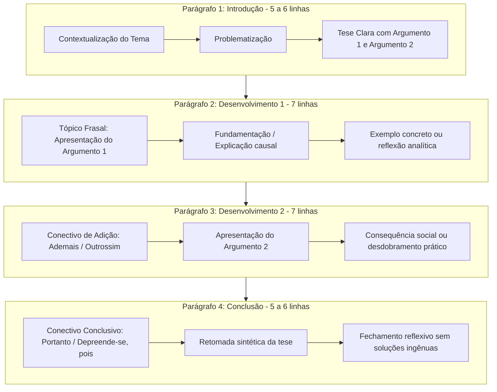

# MANUAL DE REDAÇÃO DISSERTATIVA - BANCA VUNESP (TJSP 2026)

A prova de redação do TJSP vale **40 pontos** e tem caráter **eliminatório**.  
- Nota mínima exigida para aprovação: **24 pontos (60%)** na Ampla Concorrência e **19,2 pontos** para candidatos cotistas.
- Você terá **5 horas totais** de prova para responder às 70 questões objetivas e escrever a redação definitiva.

---

## 1. As Regras de Ouro e Armadilhas do Edital 02/2026

O Edital 02/2026 trouxe alertas rigorosos que podem zerar ou penalizar severamente redações despreparadas:

### ⚠️ A Armadilha dos "Modelos Prontos" (Item 10.i do Edital)
> O edital prevê expressamente: **Serão anuladas ou severamente penalizadas redações com predomínio de reprodução de modelos prontos/decorados da internet**.
> A banca compara redações e detecta repertórios genéricos que servem para qualquer tema (ex.: "Desde a antiguidade clássica...", "Segundo o sociólogo Zygmunt Bauman..."). O corretor busca reflexão crítica, vocabulário maduro e raciocínio real conectado ao tema.

### ⚠️ O Edital NÃO é o ENEM (Item 10.f do Edital)
> No ENEM, a conclusão exige obrigatoriamente uma Proposta de Intervenção detalhada (agente, ação, meio, efeito, detalhamento).
> **Na VUNESP, NÃO é obrigatória nem recomendada proposta de intervenção!** A conclusão da VUNESP deve ser uma **síntese reflexiva** que reafirma a tese defendida e amarra os argumentos expostos.

### ⚠️ Extensão Ideal do Texto (Item 10.d do Edital)
- Menos de 8 linhas: **Nota Zero imediata**.
- 15 linhas ou menos: Perde pontos automáticos nos critérios de língua e coesão.
- 20 linhas ou menos: Proibido alcançar nota máxima nos critérios C e D.
- **Tamanho padrão recomendado**: **Entre 25 e 28 linhas** (distribuídas em 4 parágrafos bem equilibrados de 6 a 7 linhas cada).

---

## 2. Critérios de Avaliação da VUNESP

| Critério | O que é avaliado? | Como gabaritar? |
|---|---|---|
| **A: Tema** | Se o candidato compreendeu a frase temática sem tangenciamento ou fuga. | Identifique as palavras-chave do tema e use sinônimos delas logo no parágrafo de introdução. Nunca fuja do recorte proposto pela banca. |
| **B: Estrutura e Coerência** | Gênero dissertativo-argumentativo, macroestrutura (Introdução, D1, D2, Conclusão) e defesa de uma tese clara. | Mantenha tom impessoal e formal (proibido usar "eu acho", "na minha opinião" ou 2ª pessoa "você"). Construa argumentos lógicos com causa, consequência e fatos concretos. |
| **C: Língua e Registro** | Adequação gramatical, ortografia, concordância, regência, crase e precisão vocabular. | Evite gírias, clichês e repetições de palavras. Escreva com letra legível (o edital pune grafia incompreensível). |
| **D: Coesão** | Uso eficiente de conectivos interparágrafos e intraparágrafos sem repetições viciosas. | Cada parágrafo deve começar com um conectivo adequado (*Em primeiro lugar, Ademais, Por conseguinte, Portanto*). |

---

## 3. A Estrutura Perfeita em 4 Parágrafos (25 a 28 Linhas)

---

## 4. Guia de Conectivos para Cada Etapa

### Para Iniciar o D1 (Desenvolvimento 1):
- *Em primeiro plano, cabe destacar que...*
- *De início, faz-se imperioso analisar que...*
- *Sob essa perspectiva, é notório observar que...*

### Para Iniciar o D2 (Desenvolvimento 2 - Adição ou Contraponto):
- *Ademais, cumpre ressaltar que...* (se for soma de argumento)
- *Outrossim, outro fator determinante reside em...* (se for soma)
- *Por outro lado, sob um prisma divergente...* (se o tema for do tipo "dilema" ou pergunta "A tecnologia liberta ou aprisiona?")

### Para Iniciar a Conclusão:
- *Portanto, constata-se que...*
- *Depreende-se, desse modo, que...*
- *Em suma, evidencia-se a imperiosa necessidade de...*

---

## 5. Exemplo Prático de Tema e Redação Padrão VUNESP

**Tema Proposto**: *A digitalização do Poder Judiciário e os limites entre a celeridade processual e a garantia do acesso à justiça.*

### Redação Demonstrativa Nota Máxima:

> A evolução tecnológica tem transformado profundamente a prestação dos serviços públicos contemporâneos, cenário no qual o Poder Judiciário brasileiro se destaca pela ampla digitalização de seus procedimentos e adoção de plataformas virtuais. Contudo, se por um lado essa modernização fomenta uma tramitação célere dos litígios, por outro, suscita debates acerca da potencial exclusão de parcelas vulneráveis da população desprovidas de inclusão digital. Torna-se indispensável, portanto, examinar tanto os ganhos de celeridade quanto as salvaguardas essenciais à plenitude da ampla defesa.
> 
> Em primeiro plano, é inegável que a virtualização dos autos judiciais e a implantação de audiências por videoconferência conferem efetividade ao princípio constitucional da razoável duração do processo. A automação de atos de mero expediente e a dispensa de deslocamentos físicos a cartórios otimizam o tempo dos serventuários e advogados, desobstruindo varas cíveis e criminais que historicamente sofriam com a morosidade e o acúmulo de papéis. Dessa forma, a tecnologia atua como instrumento de economicidade e agilidade procedimental, viabilizando decisões mais tempestivas aos cidadãos.
> 
> Ademais, cumpre analisar que a eficiência algorítmica não pode prescindir do acolhimento humano sob pena de aprofundar desigualdades materiais. Em uma nação marcada por profundos abismos socioeconômicos e iletramento digital, exigir o manejo exclusivo de canais telemáticos sem alternativas acessíveis pode restringir o próprio direito de petição e o contraditório. O atendimento em balcões físicos e o suporte técnico a pessoas que carecem de conectividade ou letramento tecnológico configuram, assim, imperativos inegociáveis para que a modernização não se converta em barreira institucional invisível.
> 
> Infere-se, em síntese, que a transição para a justiça digital representa um marco indispensável para a contemporaneidade forense, desde que orientada pelo compromisso ético da inclusão social. A busca por produtividade quantitativa e velocidade processual deve sempre coexistir harmonicamente com a dignidade da pessoa humana e a universalidade da jurisdição, assegurando que o tribunal do futuro permaneça, prioritariamente, acessível a toda a coletividade.

---

## 6. Grade de Treinamento Quinzenal (6 Temas para Praticar)

1. **Redação 01 (Semana 05)**: *Os impactos da inteligência artificial nas relações cotidianas e no mercado de trabalho.*
2. **Redação 02 (Semana 08)**: *O teletrabalho na administração pública: equilíbrio entre qualidade de vida do servidor e eficiência do serviço.*
3. **Redação 03 (Semana 12)**: *Privacidade individual vs. segurança pública: os limites do monitoramento estatal na era dos grandes dados.*
4. **Redação 04 (Semana 14)**: *A persistência da desigualdade de gênero e seus reflexos nos espaços de poder no Brasil.*
5. **Redação 05 (Semana 16)**: *O desafio da inclusão e da acessibilidade para pessoas com deficiência no ambiente de trabalho contemporâneo.*
6. **Redação 06 (Semana 18)**: *Liberdade de expressão e disseminação de desinformação: caminhos para a preservação do debate democrático.*
